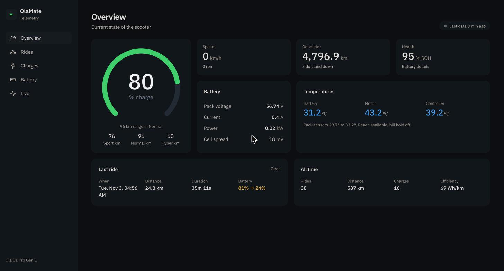
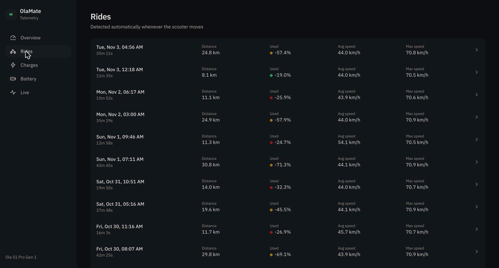
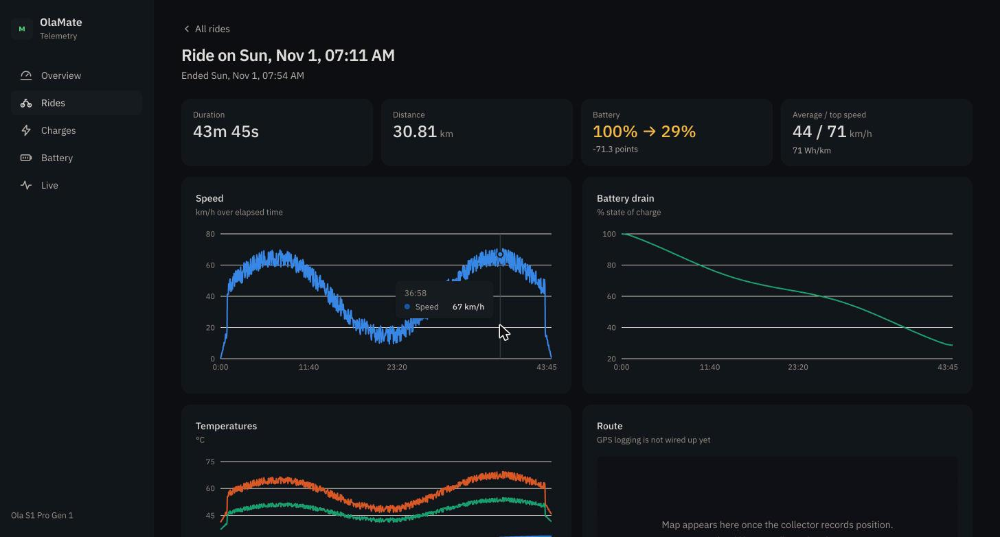
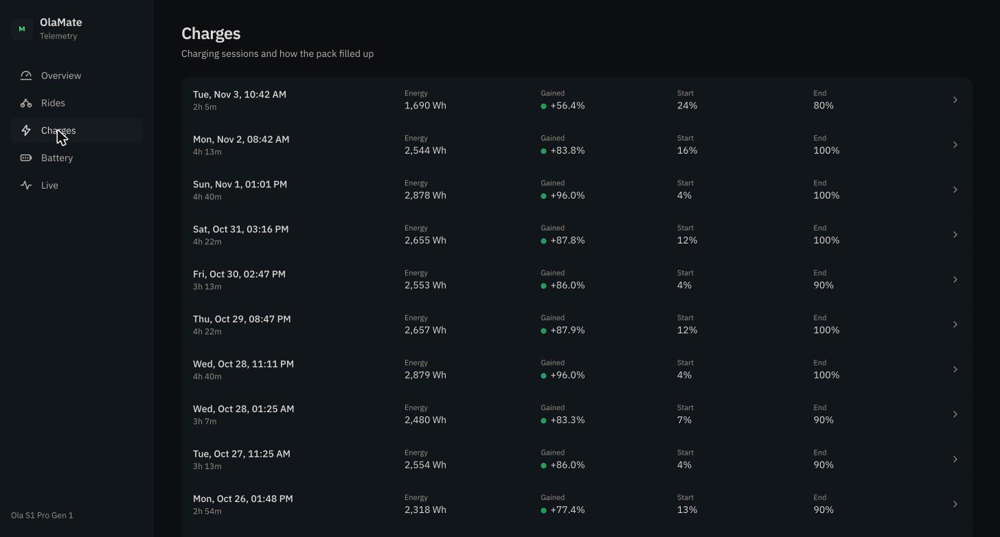
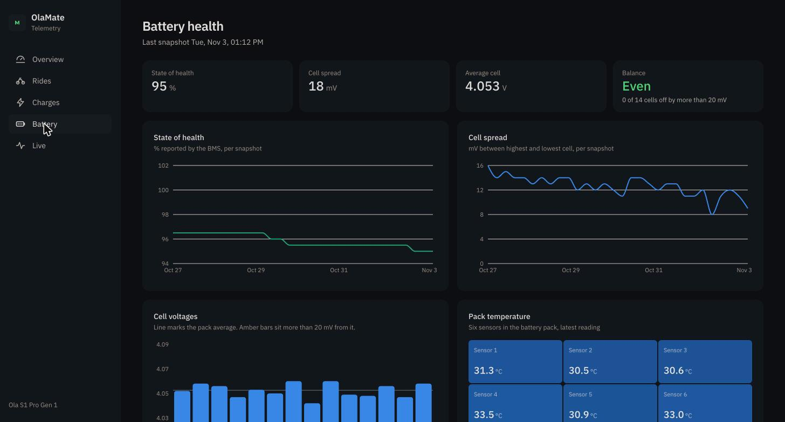
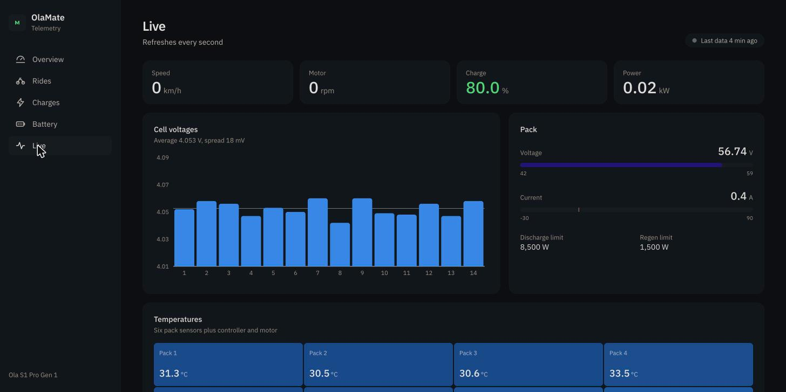

<h1 align="center">OlaMate</h1>
<p align="center">Real-time telemetry logger and battery health dashboard for the Ola S1 Pro Gen 1 electric scooter</p>
<div align="center">
  <a href="https://github.com/abhijithvijayan/olamate/blob/main/LICENSE">
    
  </a>
  <a href="https://twitter.com/intent/tweet?text=Check%20out%20OlaMate%21%20by%20%40_abhijithv%0A%0AReal-time%20telemetry%20logger%20and%20battery%20health%20dashboard%20for%20the%20Ola%20S1%20Pro%20Gen%201%20scooter%0Ahttps%3A%2F%2Fgithub.com%2Fabhijithvijayan%2Folamate%0A%0A%23OlaS1Pro%20%23EV">
     
  </a>
</div>
<h3 align="center">Made by <a href="https://twitter.com/_abhijithv">@abhijithvijayan</a></h3>
<p align="center">
  Donate:
  <a href="https://www.paypal.me/iamabhijithvijayan" target='_blank'><i><b>PayPal</b></i></a>,
  <a href="https://www.patreon.com/abhijithvijayan" target='_blank'><i><b>Patreon</b></i></a>
</p>
<p align="center">
  <a href='https://www.buymeacoffee.com/abhijithvijayan' target='_blank'>
    
  </a>
</p>
<hr />

## Table of Contents

- [What This Is](#what-this-is)
- [Compatibility](#compatibility)
- [Architecture](#architecture)
- [Dashboard](#dashboard)
- [Data Collected](#data-collected)
- [Quick Start](#quick-start)
- [Finding Your Scooter's IP](#finding-your-scooters-ip)
- [Project Structure](#project-structure)
- [Environment Variables](#environment-variables)
- [How It Works](#how-it-works)
- [Safety](#safety)
- [Disclaimer](#disclaimer)
- [Related Projects](#related-projects)
- [Contributing](#contributing)
- [Issues](#issues)
- [License](#license)

## What This Is

A telemetry logger and dashboard for the **Ola S1 Pro Gen 1** electric scooter. Reads CAN bus data from the scooter's head unit over gRPC, stores time-series telemetry in SQLite, and presents it in a real-time web dashboard.

Monitor your battery health (individual cell voltages, SOH degradation, temperature trends), track ride and charge history, and diagnose issues like sudden SOC drops — all from your browser.

Inspired by [TeslaMate](https://github.com/adriankumpf/teslamate).

## Compatibility

**Ola S1 Pro Gen 1 only.** Other Ola models (Gen 2, S1 X, S1 Air) have different CAN bus layouts and are not currently supported. The CAN signal definitions have been verified against MoveOS 3.x/4.x firmware.

## Architecture

```
Scooter (gRPC @ $SCOOTER_IP:50005)
    │  CanDumpStream (streaming CAN frames)
    ▼
Collector (Python)
    │  Decodes CAN → named signals
    │  Detects ride/charge sessions
    ▼
SQLite (olamate.db)
    │
    ▼
FastAPI → React Dashboard
```

## Dashboard

| Page | What it shows |
|------|--------------|
| **Overview** | SOC gauge, speed, range, odometer, battery stats, temps, last ride |
| **Rides** | Ride history with speed/SOC/temp charts per ride |
| **Charges** | Charge session history with SOC curve and voltage |
| **Battery Health** | SOH trend, 14-cell voltage bars, cell spread, temp heatmap |
| **Live** | Real-time 1s polling — all cells, pack gauges, all temps |

### Overview

<p align="center"></p>

### Rides

<p align="center"></p>

### Ride detail

<p align="center"></p>

### Charges

<p align="center"></p>

### Battery health

<p align="center"></p>

### Live

<p align="center"></p>

## Data Collected

- **Battery:** 14 individual cell voltages, SOC, SOH, pack voltage, current, 6 temperature sensors
- **Motor:** speed, RPM, MCU temperature, motor temperature
- **Vehicle:** odometer, range per mode (normal/sport/hyper), side stand, indicators
- **Safety:** regen availability, hill hold, fall detection, tow/theft detection

## Quick Start

### Prerequisites

- Python 3.10+
- Node.js 18+
- Scooter on the same Wi-Fi network

### Setup

```bash
git clone https://github.com/abhijithvijayan/olamate.git
cd olamate
make setup
```

Or manually:

```bash
python3 -m venv .venv && source .venv/bin/activate
pip install -r requirements.txt

# Generate gRPC stubs and fix imports
python -m grpc_tools.protoc -I proto --python_out=collector --grpc_python_out=collector proto/wifican.proto
python scripts/fix_grpc_imports.py

cd dashboard && npm install && cd ..
```

### Run

```bash
# Terminal 1 — Collector (connects to scooter, writes to SQLite)
make collector SCOOTER_IP=<scooter-ip>

# Terminal 2 — API
make api

# Terminal 3 — Dashboard
make dashboard
```

Open `http://localhost:5173`

### Demo mode (no scooter needed)

```bash
python scripts/seed_demo.py
make api &
make dashboard
```

## Finding Your Scooter's IP

The scooter's head unit runs a Wi-Fi hotspot or connects to your home network. To find its IP:

1. **If using the scooter's hotspot:** Connect to it from your laptop. The head unit is typically the gateway — run `ip route` (Linux) or `netstat -nr` (macOS) and look for the default gateway.

2. **If on the same home network:** The head unit connects via Wi-Fi. Check your router's DHCP client list for a device named something like `ola-*` or scan your network:
   ```bash
   nmap -p 50005 192.168.1.0/24 --open
   ```
   The device with port 50005 open is the scooter.

3. **Verify:** Once you have the IP, confirm with:
   ```bash
   grpcurl -plaintext <scooter-ip>:50005 list
   ```

## Project Structure

```
olamate/
  collector/
    can_decoder.py    — CAN frame decoder (18 messages, ~60 signals)
    database.py       — SQLite schema (telemetry, sessions, snapshots)
    main.py           — gRPC streaming client, session detection
    tests/            — decoder unit tests
  api/
    main.py           — FastAPI endpoints (7 routes)
    db.py             — async SQLite reads (read-only)
    metrics.py        — cell analysis, session finalization, downsampling
    tests/            — API tests
  dashboard/
    src/
      pages/          — Overview, Rides, Charges, BatteryHealth, Live
      components/     — SocGauge, CellBarChart, TempHeatmap, TimeSeriesChart, ...
      api/            — typed fetch client + React hooks
  proto/
    wifican.proto     — gRPC service definition (extracted from head unit)
  scripts/
    seed_demo.py      — generates 14 days of synthetic data
    fix_grpc_imports.py — patches generated stubs for package imports
    analyze_soc_drop.py — diagnose sudden SOC drops from logged data
```

## Environment Variables

| Variable | Default | Description |
|----------|---------|-------------|
| `SCOOTER_IP` | *(required)* | Scooter's IP on local network |
| `GRPC_PORT` | `50005` | gRPC port on the scooter |
| `DB_PATH` | `./olamate.db` | SQLite database path |

## How It Works

The Ola S1 Pro Gen 1's Android head unit runs a gRPC service (`diagnostics_server`) on port 50005. This is a factory diagnostic tool — the same interface Ola's own technician tools use. The `CanDumpStream` RPC continuously delivers raw CAN bus frames.

Each CAN frame is 16 bytes: 4B CAN ID (big-endian) + 1B DLC + 3B padding + 8B data. The collector decodes these using signal definitions (Intel/little-endian, `physical = raw × scaling + offset`) and writes to SQLite every second. Below 30% SOC, logging increases to every 0.5s to capture battery behavior during low-charge events.

The battery pack is 14S NMC with individual cell voltages on CAN IDs 0x1A5–0x1AA, pack data on 0x120/0x140/0x150/0x160, and 6 temperature sensors on 0x1A4/0x1A7.

### Tech stack

- **Collector:** Python, grpcio, sqlite3
- **API:** FastAPI, aiosqlite
- **Dashboard:** React, TypeScript, Vite, TailwindCSS, Recharts
- **Database:** SQLite

## Safety

- **Read-only** — the collector never writes CAN frames or sends commands to the scooter
- The gRPC service is a factory diagnostic tool shipped by Ola Electric in the stock firmware
- No personal data (VIN, Wi-Fi credentials) is stored or exposed

## Disclaimer

This is an independent interoperability research project for vehicles I personally own. It is not affiliated with, endorsed by, or sponsored by Ola Electric Mobility Limited or any of its subsidiaries. All trademarks and product names are the property of their respective owners.

**No warranty.** THE SOFTWARE IS PROVIDED "AS IS," WITHOUT WARRANTY OF ANY KIND, EXPRESS OR IMPLIED. THE AUTHOR MAKES NO REPRESENTATIONS OR WARRANTIES REGARDING THE ACCURACY, COMPLETENESS, SAFETY, OR SUITABILITY OF ANY INFORMATION OR CODE IN THIS REPOSITORY.

**Limitation of liability.** IN NO EVENT SHALL THE AUTHOR BE LIABLE FOR ANY DIRECT, INDIRECT, INCIDENTAL, SPECIAL, CONSEQUENTIAL, OR EXEMPLARY DAMAGES ARISING FROM THE USE OR INABILITY TO USE THIS SOFTWARE, EVEN IF ADVISED OF THE POSSIBILITY OF SUCH DAMAGES. You assume all risk.

**For owner-authorized use only.** This tool is intended for diagnostics and telemetry logging on vehicles you personally own. Using it on a vehicle you do not own constitutes unauthorized access and may violate applicable laws including but not limited to the Information Technology Act, 2000 (India), the Computer Fraud and Abuse Act (US), the Computer Misuse Act (UK), and equivalent legislation in your jurisdiction. You are solely responsible for ensuring your use complies with all applicable laws.

**Interoperability research.** This project exercises the owner's right to understand and interoperate with software running on hardware they own. The gRPC protocol definition was extracted from the `diagnostics_server` binary on the author's own scooter. No proprietary source code is reproduced.

## Related Projects

| Project | Description |
|---------|-------------|
| [ola-s1-pro-gen1](https://github.com/abhijithvijayan/ola-s1-pro-gen1) | Reverse engineering docs, CAN database, gRPC proto analysis for the Ola S1 Pro Gen 1 |
| [ola-s1-rea](https://github.com/AnotherDayWasted/ola-s1-rea) | Community reverse engineering (E2 platform): root docs, CAN map, diagnostics app |
| [ola-dash-sdk](https://github.com/AnotherDayWasted/ola-dash-sdk) | Slint-based replacement dashboard for Gen 1: runtime themes, plugins |

## Contributing

See [CONTRIBUTING.md](CONTRIBUTING.md) for guidelines.

## Issues

Looking to contribute? Feel free to create issues for bugs, feature requests, or questions about CAN signal mapping.

If you want to help but don't know where to start, there are [areas where help is welcome](CONTRIBUTING.md#areas-where-help-is-welcome).

## License

[MIT](LICENSE)
